# 01 — Plano de implementação

Repo: `forks/mba-ia-refactor-projects-skill`  
Base do design: [`../research/04-skill-design-implications.md`](../research/04-skill-design-implications.md)

## Objetivo do Implement

Entregar a skill `refactor-arch`, executá-la nos 3 projetos, gerar reports, atualizar README e commitar código refatorado — cumprindo os critérios 3/3 do desafio.

## Ordem de trabalho (Implement)

```mermaid
flowchart LR
  A[Manual analysis notes] --> B[Author skill in project1]
  B --> C[Dry-run Phase1-2 project1]
  C --> D[Iterate refs if needed]
  D --> E[Phase3 project1 + report1]
  E --> F[Copy skill to project2 and project3]
  F --> G[Run project2 + report2]
  G --> H[Run project3 + report3]
  H --> I[Update root README]
  I --> J[Commits per project + final push]
```



| Step | Ação | Saída |
|------|------|-------|
| 0 | Análise manual formal (≥5 smells/projeto) | Conteúdo para README seção A |
| 1 | Criar skill em `code-smells-project/.claude/skills/refactor-arch/` | 6 arquivos |
| 2 | Executar `/refactor-arch` no projeto 1 (Fases 1–2; confirmar; Fase 3) | Código MVC + `reports/audit-project-1.md` |
| 3 | Iterar refs se findings &lt; 5 ou validação falhar | Refs ajustados |
| 4 | `cp -R` skill → `ecommerce-api-legacy/` e `task-manager-api/` | Skill idêntica |
| 5 | Executar nos projetos 2 e 3 | Código + `audit-project-2/3.md` |
| 6 | Atualizar README raiz (A–D) | Documentação do entregável |
| 7 | Commits + push do resultado do Implement | Repo público atualizado |

**Este Plan não executa os steps 0–7.** Só documenta como fazê-los.

---

## Step 0 — Análise Manual (insumo do README)

Para cada projeto, documentar ≥5 problemas com severidade + justificativa + arquivo:linha, usando o landscape ([`../research/03-projects-landscape.md`](../research/03-projects-landscape.md)) e releitura do código.

Distribuição mínima por projeto: 1 CRITICAL/HIGH + 2 MEDIUM + 2 LOW.

Não precisa listar todos os smells — priorizar impacto arquitetural.

---

## Step 1 — Autoría da skill

### Path canônico

`code-smells-project/.claude/skills/refactor-arch/`

### Arquivos a criar

| Arquivo | Área | Conteúdo obrigatório |
|---------|------|----------------------|
| `SKILL.md` | Workflow | Frontmatter + 3 fases + gates + links 1 nível |
| `project-analysis.md` | Análise | Heurísticas linguagem/framework/DB/arquitetura + formato do resumo Fase 1 |
| `anti-patterns.md` | Catálogo | ≥8 anti-patterns; sinais; severidade; deprecated APIs |
| `report-template.md` | Relatório | Template exato Fase 2 |
| `mvc-architecture.md` | MVC | Responsabilidades Models / Views-Routes / Controllers / Config / Errors |
| `refactor-playbook.md` | Playbook | ≥8 transformações before/after (Python + Node quando couber) |

### `SKILL.md` — especificação

```yaml
---
name: refactor-arch
description: Analyzes a backend codebase, audits MVC/SOLID anti-patterns with severity, and refactors to MVC after human confirmation. Use when invoked as /refactor-arch or when the user requests automated architectural refactoring.
disable-model-invocation: true
---
```

Body deve conter:

1. Instrução: executar fases em ordem; carregar refs listados por fase
2. **Phase 1:** ler `project-analysis.md` → imprimir bloco `PHASE 1: PROJECT ANALYSIS`
3. **Phase 2:** ler `anti-patterns.md` + `report-template.md` → emitir relatório → **STOP** com `Proceed with refactoring (Phase 3)? [y/n]` → **proibir qualquer write** até `y`
4. **Phase 3:** ler `mvc-architecture.md` + `refactor-playbook.md` → aplicar transformações adaptativas → validar boot + endpoints → imprimir `PHASE 3: REFACTORING COMPLETE`
5. Regra de adaptação: se arquitetura = partial layers, realinhar; se flat/god-class, rebuild MVC

### `project-analysis.md` — especificação

Heurísticas:

| Detectar | Sinais |
|----------|--------|
| Python | `*.py`, `requirements.txt`, `pyproject.toml` |
| Node | `package.json`, `*.js`/`*.ts` |
| Flask | import `flask`, `Flask(` |
| Express | `express`, `require('express')` |
| SQLAlchemy | `flask_sqlalchemy` / `SQLAlchemy` |
| sqlite3 raw | `import sqlite3` / `require('sqlite3')` |
| Domínio | nomes de rotas, models, README do projeto |
| Arquitetura | flat (poucos arquivos raiz) / god-class (1 módulo enorme) / partial (pastas models+routes) |
| DB tables | schema SQL, models ORM, seeds |

Output Fase 1 (campos mínimos): Language, Framework, Dependencies, Domain, Architecture, Source files, DB tables.

### `anti-patterns.md` — catálogo mínimo (10)

Implementar exatamente estes (ou equivalente com mesmos sinais), com Detection / Severity / Impact / Recommendation:

1. God Class / God Module — CRITICAL  
2. Hardcoded Credentials / Secrets — CRITICAL  
3. SQL Injection / Arbitrary Client Query — CRITICAL  
4. Sensitive Data Exposure — CRITICAL/HIGH  
5. Fat Controller / Business in Routes — HIGH  
6. Global Mutable State / Missing DI — HIGH  
7. Weak / Fake Auth — HIGH  
8. N+1 Queries — MEDIUM  
9. Deprecated / Legacy APIs — MEDIUM (incluir `datetime.utcnow`, `Model.query.get`, callback-only sqlite)  
10. Magic Numbers / Cryptic Naming / Dead Code — LOW  

Cada entry: sinais acionáveis (regex/padrão de código), não apenas descrição.

### `report-template.md`

Espelhar o exemplo do enunciado:

- Header Project / Stack / Files / LOC  
- Summary `CRITICAL: N | HIGH: N | MEDIUM: N | LOW: N`  
- Findings ordenados CRITICAL → LOW  
- Bloco por finding: título, File, Description, Impact, Recommendation  
- Total + prompt de confirmação

### `mvc-architecture.md`

Regras de responsabilidade + estrutura alvo ilustrativa (Python Flask e Node Express) + regra condicional rebuild vs realign.

### `refactor-playbook.md` — ≥8 transformações

Incluir no mínimo:

1. Extract config/secrets → env + settings module  
2. Split God Class → models + controllers + routes por domínio  
3. Parametrize SQL / remove arbitrary admin query  
4. Move business logic routes → controllers  
5. Centralize error handling  
6. Fix N+1 (join / eager load)  
7. Replace deprecated APIs  
8. Remove dead code / fix bounded context  
9. Fix password hashing / stop leaking secrets  
10. Thin composition-root entrypoint  

Cada uma: Before + After (snippet). Dual-stack onde o smell existe nos dois mundos.

---

## Steps 2–5 — Execução e reports

### Projeto 1 — `code-smells-project`

```bash
cd code-smells-project
claude "/refactor-arch"
```

- Confirmar Fase 1 (Python + Flask + e-commerce)
- Fase 2 ≥5 findings (≥1 CRITICAL/HIGH); salvar output em `reports/audit-project-1.md`
- Confirmar `y` → Fase 3 → smoke (`pip install`, `python app.py`, curl health/produtos/login)

### Projeto 2 — `ecommerce-api-legacy`

```bash
cp -R code-smells-project/.claude ecommerce-api-legacy/
cd ecommerce-api-legacy
claude "/refactor-arch"
```

- Stack Node + Express + LMS
- Report → `reports/audit-project-2.md`
- Smoke: `npm install && npm start` + `api.http` (checkout, financial-report)

### Projeto 3 — `task-manager-api`

```bash
cp -R code-smells-project/.claude task-manager-api/
cd task-manager-api
claude "/refactor-arch"
```

- Detectar Task Manager + partial layers
- Fase 3 **realinha** (não rebuild cego)
- Report → `reports/audit-project-3.md`
- Smoke: `python seed.py && python app.py` + endpoints tasks/reports

### Iteração

Se Fase 2 &lt; 5 findings ou Fase 3 quebrar: ajustar `anti-patterns.md` / `refactor-playbook.md` / `SKILL.md`, recopiar skill, reexecutar. Esperado 2–4 ciclos.

### Conflito de porta

Projetos 1 e 3 usam **5000** — validar um por vez.

---

## Step 6 — README raiz

Substituir/expandir o README do desafio com seções do enunciado:

| Seção | Fonte |
|-------|-------|
| A Análise Manual | Step 0 + landscape |
| B Construção da Skill | Design deste Plan + decisões research |
| C Resultados | Contagens dos 3 reports + before/after + checklist + logs |
| D Como Executar | Claude Code, comandos `/refactor-arch`, validação |

Manter referência ao repo base / fork.

---

## Step 7 — Git (Implement)

Sugestão de commits (no Implement, não agora):

1. `feat: add refactor-arch skill` (skill nos 3 projetos)  
2. `refactor: apply MVC to code-smells-project` + report 1  
3. `refactor: apply MVC to ecommerce-api-legacy` + report 2  
4. `refactor: improve MVC alignment on task-manager-api` + report 3  
5. `docs: update README with analysis, results, and how-to`

---

## Critérios de aceite (Definition of Done)

| Critério | Projetos |
|----------|----------|
| Fase 1 stack correta | 3/3 |
| Fase 2 ≥5 findings | 3/3 |
| Fase 2 ≥1 CRITICAL ou HIGH | 3/3 |
| Fase 2 pede confirmação | 3/3 |
| Fase 3 app sobe + endpoints OK | 3/3 |
| Skill presente em `.claude/skills/refactor-arch/` | 3/3 |
| Reports em `reports/` | 3 arquivos |
| README com seções A–D | 1 |

Checklist detalhado por fase: [`../research/01-requirements-must.md`](../research/01-requirements-must.md).

---

## Fora de escopo deste Plan

- Escrever os arquivos da skill (Implement)
- Rodar Claude Code / refatorar código
- Gerar `reports/`
- Commits do resultado do Implement

## Gate antes do Implement

Commit + push de **Research + Plan** (`docs/`) no fork, sem alterar os 3 projetos ainda.
