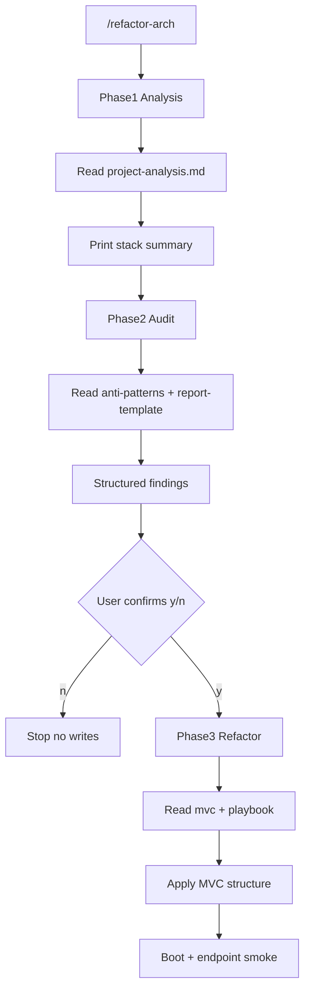

# 04 — Implicações de design (input da fase Plan)

Decisões derivadas do Research. A fase **Plan** deve implementar a skill a partir deste documento (sem reabrir alternativas).

## Decisão: ferramenta e path

| Item | Valor fixado |
|------|----------------|
| Ferramenta | Claude Code |
| Skill name | `refactor-arch` |
| Path canônico | `{projeto}/.claude/skills/refactor-arch/` |
| Invocação | `claude "/refactor-arch"` |
| Frontmatter | `name`, `description`, `disable-model-invocation: true` |

Ordem de criação: implementar a skill primeiro em `code-smells-project/`, depois **copiar** a pasta inteira para `ecommerce-api-legacy/` e `task-manager-api/`.

## Layout fixado da skill

```
.claude/skills/refactor-arch/
├── SKILL.md                 # workflow 3 fases + gates + links
├── project-analysis.md      # Área: análise de projeto
├── anti-patterns.md         # Área: catálogo (≥8 + deprecated)
├── report-template.md       # Área: template de relatório
├── mvc-architecture.md      # Área: guidelines MVC
└── refactor-playbook.md     # Área: playbook (≥8 transformações)
```

Os cinco arquivos cobrem exatamente as cinco áreas obrigatórias do enunciado.

## Conteúdo do `SKILL.md` (contrato)

1. Carregar refs sob demanda por fase (progressive disclosure)
2. Executar fases **em ordem**; não pular gates
3. **Zero writes** até confirmação explícita `y` após a Fase 2
4. Na Fase 3: adaptar profundidade ao nível de organização detectado na Fase 1
5. Validar com boot + smoke; se falhar, corrigir e revalidar (feedback loop)

### Gates obrigatórios

| Gate | Comportamento |
|------|----------------|
| Após Fase 1 | Resumo impresso no estilo do enunciado (Language, Framework, Domain, Architecture, Source files, DB…) |
| Após Fase 2 | Relatório completo → pergunta `Proceed with refactoring (Phase 3)? [y/n]` |
| `n` / ausência de `y` | Encerrar sem modificar arquivos |
| Após Fase 3 | Checklist de validação: boot OK + endpoints OK |

## Fluxo



## Catálogo mínimo (≥8) — mapeado ao landscape

Severidades distribuídas; sinais devem ser stack-agnósticos quando possível.

| # | Anti-pattern | Severidade | Sinais (resumo) |
|---|--------------|------------|-----------------|
| 1 | God Class / God Module | CRITICAL | Um arquivo concentra DB schema + rotas + regras de negócio |
| 2 | Hardcoded Credentials / Secrets | CRITICAL | Secrets, API keys, SMTP, SECRET_KEY literais no source |
| 3 | SQL Injection / Arbitrary Query | CRITICAL | SQL concatenado com input; `execute` de query do client |
| 4 | Sensitive Data Exposure | CRITICAL/HIGH | Senha plaintext, hash em `to_dict`, card log, health vazando secret |
| 5 | Fat Controller / Business in Routes | HIGH | Validação pesada, orquestração e SQL/ORM dentro do handler HTTP |
| 6 | Global Mutable State / Missing DI | HIGH | Singleton conexão/cache global; config acoplada a módulo |
| 7 | N+1 Queries | MEDIUM | Query dentro de loop; nested cursors; `get` por item em lista |
| 8 | Deprecated / Legacy APIs | MEDIUM/LOW | `datetime.utcnow()`, `Model.query.get`, callbacks sqlite sem promises |
| 9 | Weak / Fake Auth | HIGH | MD5, token fake sem middleware, rotas admin abertas |
| 10 | Magic Numbers / Naming / Dead Code | LOW | Constantes soltas, nomes crípticos (`usr`/`cc`), service nunca importado |

O Plan deve garantir **≥8 no arquivo final** com detection signals + severity + recommendation; itens 9–10 reforçam cobertura HIGH/LOW.

## Playbook mínimo (≥8 transformações)

Cada entrada: **Before (conceito)** → **After (MVC)** com snippet Python e/ou Node.

1. Extrair config/secrets → `config/settings` + env
2. Quebrar God Class → models + controllers + routes por domínio
3. Parametrizar SQL / banir query arbitrário do client
4. Mover business logic de routes → controllers (ou services se já existir camada)
5. Introduzir error handling centralizado (middleware / `@app.errorhandler`)
6. Eliminar N+1 (join / eager load / query única)
7. Substituir APIs deprecated (`utcnow` → timezone-aware; `query.get` → `session.get`)
8. Remover dead code / realinhar bounded contexts (ex.: categories fora de report)
9. Hash/auth adequado (sem plaintext/MD5; não retornar secrets)
10. Entry point fino como composition root

## Target MVC (agnóstico)

Estrutura alvo **ilustrativa** (nomes adaptados à stack):

```
src/   # ou raiz do app, conforme convenção da stack
├── config/          # settings sem secrets hardcoded
├── models/          # acesso a dados / entidades
├── views/ ou routes/# roteamento HTTP apenas
├── controllers/     # orquestração do fluxo
├── middlewares/     # errors, auth (se aplicável)
└── app entry        # composition root
```

Regras (detalhar em `mvc-architecture.md`):

- **Models:** dados e persistência; sem HTTP
- **Views/Routes:** binding HTTP ↔ controller; sem SQL pesado
- **Controllers:** fluxo da aplicação; dependências explícitas
- **Config:** ambiente; zero credentials no source
- **Errors:** handler único

### Condicional por organização detectada

| Organização (Fase 1) | Estratégia Fase 3 |
|----------------------|-------------------|
| Flat / God class | Rebuild MVC completo preservando contratos de endpoints |
| Partial layers | Realinhar: extrair controllers, config, errors; corrigir smells; não apagar ORM/blueprints sem necessidade |

## Validação stack-agnóstica

Heurística na Fase 1 / 3:

| Sinal | Boot | Smoke |
|-------|------|-------|
| `requirements.txt` + Flask | `pip install -r …` + `python app.py` (ou seed) | GET health/root + endpoints mapeados |
| `package.json` + Express | `npm install` + `npm start` | Usar `api.http` se existir + principais rotas |

Documentar no relatório (ou output Fase 3) o resultado do smoke.

## Relatório Fase 2

Seguir template em `report-template.md`, alinhado ao exemplo do enunciado:

- Header (Project, Stack, Files, LOC estimado)
- Summary counts por severidade
- Findings ordenados CRITICAL → LOW
- Cada finding: título, File:`path:lines`, Description, Impact, Recommendation
- Total de findings
- Prompt de confirmação

## Entregáveis pós-execução (Implement — não Research)

| Artefato | Destino |
|----------|---------|
| Output Fase 2 projeto 1 | `reports/audit-project-1.md` |
| Output Fase 2 projeto 2 | `reports/audit-project-2.md` |
| Output Fase 2 projeto 3 | `reports/audit-project-3.md` |
| README raiz | Análise Manual + Construção + Resultados + Como Executar |

## Critérios de pronto da skill (antes de copiar aos outros projetos)

- [ ] 5 refs presentes e linkados no `SKILL.md`
- [ ] Catálogo ≥ 8 com deprecated
- [ ] Playbook ≥ 8 before/after
- [ ] Gate `[y/n]` explícito
- [ ] Instruções de validação Fase 3
- [ ] Nenhum path hardcoded exclusivo de um único projeto

## Próxima fase RPI

**Plan** — detalhar implementação arquivo a arquivo da skill, ordem de análise manual no README, sequência de execução nos 3 projetos e smoke commands concretos por stack.
